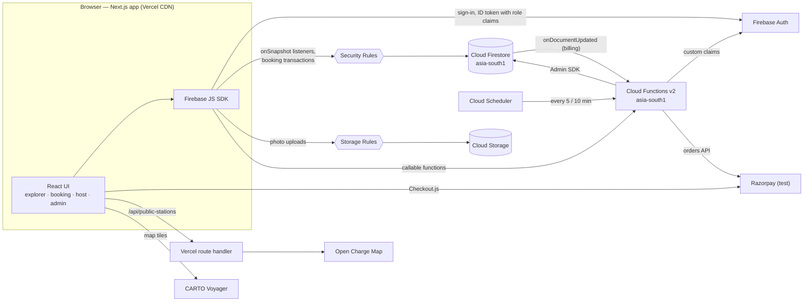

# VoltShare

**Peer-to-peer EV charger booking for Indian cities.** Hosts list the chargers at their homes, cafés, hotels and housing societies in bookable 30-minute slots; renters — apartment dwellers, cab and delivery drivers, travellers — find one on a live map, book, self check-in with a PIN and pay per kWh.

Built for a university hackathon (Energy Systems / Transportation) to demonstrate **scalability, real-time sync, secure role-based access and high availability** on Firebase + Vercel. The full write-up is in [`REPORT.md`](REPORT.md).

> **Demo data is fictional.** The 15 seeded Bengaluru chargers, their hosts, addresses, photos, ratings and booking history are invented and shown with a **“Demo listing”** tag. Neighbourhood coordinates are real; house-level details are not. Anything listed through *Host Mode → Add charger* is a real, working listing.

---

## Features

| | |
|---|---|
| **Roles** | `renter` / `host` / `admin` as Firebase Auth **custom claims** set only by Cloud Functions; one account can rent and host. Instant `Find a Charger \| Host Mode` switcher. |
| **Map explorer** | Split screen (cards + Leaflet map with CARTO Voyager tiles), colour-coded price-pill pins (available / charging / busy), hover-linked cards ↔ pins, filters, geohash queries, mobile full-screen map with a draggable bottom sheet. |
| **Listings** | Photos (Storage), connector (Type 2 / CCS2 / 15A), kW, ₹/kWh, access type, rules, hours, map pin picker. Public doc gets a location fuzzed 120–250 m; exact address lives in a private sub-document. |
| **Double-booking-proof slots** | One Firestore doc per slot, ID `{chargerId}_{YYYY-MM-DD}_{HHmm}`, multi-slot bookings written atomically in one transaction. Live slot pills across all tabs, *“Slot just taken!”* toasts, and a **Simulate concurrent booking** demo. |
| **Privacy** | Exact address / gate code readable only by the host, admins, or a renter holding a `renterAccess` grant that a Cloud Function creates on confirmation and removes after the slot. |
| **Self check-in & check-out** | 4-digit PIN + time window + **≤100 m geofence verified server-side** → dark live-telemetry card (kWh ring, elapsed, running cost) → check-out with kWh reading + optional meter photo. |
| **Billing & earnings** | A Firestore trigger computes `kWh × rate + 15% fee` and aggregates host earnings; never computed on the client. |
| **Host dashboard** | Live earnings counter, booking timeline, 7-day & per-charger charts, online/offline toggles, *DISCOM EV Meter Verified* badge, recent sessions with meter photos. |
| **Admin** | Platform totals, verify hosts / grant roles, take listings offline, mark meters verified. |
| **Payments** | Razorpay **test mode** (server-created order + signature verification) when keys are set; otherwise a mocked checkout. |
| **Public stations** *(optional)* | Real public stations from Open Charge Map as a grey, non-bookable layer. |

## Architecture



**Cloud Functions** (`functions/src`, region `asia-south1`)

| Function | Type | Does |
|---|---|---|
| `becomeHost`, `adminSetUserRoles` | callable | set custom claims, mirror roles to `users/{uid}`, sync verified badge to listings |
| `confirmBooking` | callable | verify payment → `confirmed`, issue PIN, create `renterAccess` |
| `cancelBooking` | callable | renter/host/admin cancels → archive to `bookingHistory`, free slots, revoke access |
| `simulateRivalBooking` | callable | the “Rival Driver” side of the concurrency demo |
| `checkIn` / `checkOut` | callable | PIN + window + geofence / validated kWh reading |
| `billOnComplete` | Firestore trigger | bill the session, increment `hostStats` and `platformStats` (idempotent) |
| `releaseExpiredHolds` | scheduled, 5 min | free unpaid 10-minute holds |
| `revokeExpiredAccess` | scheduled, 10 min | delete expired address grants, auto-close forgotten sessions |
| `createPaymentOrder` | callable | Razorpay order with a server-computed amount |

**Data model** (Firestore)

```
users/{uid}                          name, email, photo, roles[], verifiedHost, claimsUpdatedAt
chargers/{id}                        ownerId, hostName, hostVerified, title, photos[], connector, powerKw,
                                     ratePerKwh, accessType, rules[], openTime, closeTime,
                                     approxLat, approxLng, geohash, area, city, online, liveStatus,
                                     meterVerified, rating, reviewCount, demo?
chargers/{id}/private/details        address, exactLat, exactLng, accessNotes
bookings/{chargerId_date_HHmm}       groupId, groupSlots[], chargerId, renterId, renterName, ownerId, date,
                                     slot, startAt, endAt, status, ratePerKwh, powerKw, pin,
                                     kwh, energyCost, platformFee, amount, hostEarning, …
slots/{chargerId_date_HHmm}          chargerId, date, slot, status         (public, no personal data)
renterAccess/{chargerId_uid}         renterId, ownerId, expiresAt          (Cloud Functions only)
bookingHistory/{groupId}             cancelled / expired bookings          (Cloud Functions only)
hostStats/{uid}, platformStats/global                                      (billing trigger only)
```

**Project layout**

```
src/app/            routes: / (landing), /explore, /chargers/[id], /bookings, /host, /host/chargers/…, /admin, /login, /api/public-stations
src/components/     ui · layout · auth · explore · map (swappable MapView) · charger · booking · host · landing
src/hooks/, src/lib/  Firestore hooks, booking transaction, time/geo helpers, Razorpay & Open Charge Map clients
functions/src/      Cloud Functions (auth/roles, bookings, sessions & billing, payments)
firestore.rules · storage.rules · firestore.indexes.json · firebase.json
tests/rules/        security-rules tests (emulator)        tests/unit/   unit tests
scripts/            seed.ts · make-admin.ts · gen-demo-art.mjs
```

## Run locally — no keys needed

Requires **Node 22** and **Java 21+** (Firebase emulators).

```bash
npm install                 # also installs functions/ dependencies
cp .env.example .env.local  # NEXT_PUBLIC_USE_EMULATORS=true
npm run emulators           # terminal 1 — Emulator UI at http://127.0.0.1:4000
npm run seed                # terminal 2 — demo accounts, chargers, bookings
npm run dev                 # terminal 2 — http://localhost:3000
```

**Demo accounts** (password `demo1234`): `renter@demo.com`, `host@demo.com`, `admin@demo.com` — one-click buttons on the login page. `npm run seed` resets the emulator to the demo state every time.

Scheduled functions don't fire on their own in the emulator; everything else (callables, the billing trigger) does.

## Environment variables

**Next.js — `.env.local` and Vercel → Settings → Environment Variables**

| Variable | Required | Notes |
|---|---|---|
| `NEXT_PUBLIC_FIREBASE_API_KEY` | yes | Firebase console → Project settings → Your apps → Web app. These values are public by design; Security Rules protect the data. |
| `NEXT_PUBLIC_FIREBASE_AUTH_DOMAIN` | yes | |
| `NEXT_PUBLIC_FIREBASE_PROJECT_ID` | yes | |
| `NEXT_PUBLIC_FIREBASE_STORAGE_BUCKET` | yes | e.g. `your-project.firebasestorage.app` |
| `NEXT_PUBLIC_FIREBASE_MESSAGING_SENDER_ID` | yes | |
| `NEXT_PUBLIC_FIREBASE_APP_ID` | yes | |
| `NEXT_PUBLIC_USE_EMULATORS` | yes | `true` locally, `false` on Vercel |
| `NEXT_PUBLIC_RAZORPAY_KEY_ID` | optional | Razorpay **test** key id (`rzp_test_…`). Blank → mocked checkout. |
| `OCM_API_KEY` | optional | Open Charge Map key — **server-side only, no `NEXT_PUBLIC_`**. Blank → public-stations layer off. |

**Cloud Functions — `functions/.env`** (gitignored; copy from `functions/.env.example`)

| Variable | Notes |
|---|---|
| `RAZORPAY_KEY_ID`, `RAZORPAY_KEY_SECRET` | Razorpay **test** keys. When set, the server *requires* a valid Razorpay signature and refuses mock payments. Set both here **and** `NEXT_PUBLIC_RAZORPAY_KEY_ID` in Vercel, or neither. |

## Deploy

**1 · Firebase project** (console.firebase.google.com)
1. Create the project and upgrade to the **Blaze** plan (needed for Cloud Functions; hackathon traffic stays within the free tier — set a budget alert).
2. **Authentication** → enable *Email/Password* and *Google*.
3. **Firestore** → create database in **`asia-south1` (Mumbai)**, production mode. **Storage** → get started, same region.
4. **Project settings → Your apps → Web (`</>`)** → register an app; copy the config values for the env vars above.

**2 · Rules, indexes and functions** (from the repo folder)
```bash
npx firebase login
npx firebase use --add          # pick your project, alias "default" (updates .firebaserc — commit it)
npx firebase deploy --only firestore,storage,functions
```
- First deploy enables the required Google Cloud APIs automatically (this can take a few minutes; re-run if it times out).
- If asked to let Storage rules read Firestore (used to let hosts view meter photos), answer **yes**.
- If asked about a cleanup policy for function images, accept the default.

**3 · Demo data and your admin account**
1. Firebase console → Project settings → **Service accounts → Generate new private key**. Save the JSON **outside** the repo (e.g. `C:\keys\voltshare.json`) and never commit or share it.
2. ```bash
   npm run seed -- --prod --project <project-id> --key C:\keys\voltshare.json --yes
   ```
   On a real project the seed never deletes anything, and adds the fictional booking history only once.
3. Sign in to the deployed app once with your own account, then:
   ```bash
   npm run make-admin -- you@example.com --prod --project <project-id> --key C:\keys\voltshare.json --yes
   ```

**4 · Vercel**
1. vercel.com → **Add New Project** → import this GitHub repo (framework auto-detected as Next.js).
2. Add the environment variables above (`NEXT_PUBLIC_USE_EMULATORS=false`) → **Deploy**.
3. Firebase console → Authentication → Settings → **Authorized domains** → add your `*.vercel.app` domain (needed for Google sign-in).

Every push to `main` redeploys automatically, and GitHub Actions (`.github/workflows/ci.yml`) runs type-checks, unit tests, the security-rules tests and a production build.

## Tests

```bash
npm run test:rules   # 36 Firestore + Storage security-rules tests (starts the emulators itself)
npm run test:unit    # Open Charge Map mapping, Razorpay signature verification
```

The rules suite includes the three required cases — *a renter can't read private details without a booking*, *a renter can't write another user's booking*, *nobody can create a booking for a taken slot* — plus role escalation, badge forging, price tampering, out-of-hours / past bookings, slot-lock griefing, grant forging, and earnings privacy.

## Demo script (≈5 minutes)

1. **Landing** → *Find a charger*. Show the split-screen map, hover cards ↔ pins, filter **CCS2**, drag the map → *Search this area*. On a phone: bottom sheet + List/Map toggle.
2. Open **Corner café fast charger** → approximate 300 m circle and the lock notice.
3. Sign in as **Renter**. Pick tomorrow, select 3 slots → *Reserve* → *Authorise* → *View my booking*: PIN, exact address and gate notes now unlocked.
4. **Concurrency**: open the same charger in two windows (Renter + Host account), select the same slot in both, book in one → the other gets *“Slot just taken!”* and the pill locks. Then press **Simulate concurrent booking** — exactly one of *You* / *Rival Driver* wins.
5. **Live session**: on **Lakeside hotel porch charger** (open 24 h) book the current slot, *Check in* → *Demo: pretend I'm at the charger* → PIN → watch the dark telemetry card; the map pin turns amber for everyone. *Unplug & check out* → server-computed receipt.
6. Switch to **Host Mode** (as `host@demo.com`): live earnings counter, timeline, charts; flip a charger **Offline** and watch it vanish from the map in the other window.
7. **Admin**: platform totals, verify a host, mark a meter verified.

## Map provider

`src/components/map/MapView.tsx` lazy-loads `LeafletMap.tsx` behind a provider-neutral contract (`types.ts`). To switch to the Google Maps JS API, implement the same props in `GoogleMap.tsx` and change the one dynamic import.
