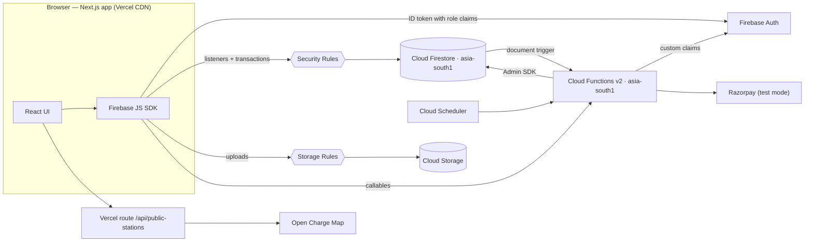

# VoltShare — Project Report

*Peer-to-peer EV charger booking · Domain: Energy Systems / Transportation*
*Stack: Next.js on Vercel · Firebase Auth, Cloud Firestore, Cloud Storage, Cloud Functions (2nd gen)*

---

## 1. Problem statement

India's urban EV adoption is growing fastest among people who have the least access to charging. Most city residents live in apartments, where installing a personal charger needs society approval, a dedicated parking spot and often a separate electricity connection. Cab and delivery drivers — whose vehicles run all day — rarely have a home charger at all. Public charging stations exist, but they are comparatively few, unevenly spread and frequently occupied.

At the same time, a growing number of **private chargers** — at independent homes, cafés, hotels, offices and housing societies — sit idle for most of the day.

**VoltShare** connects the two: hosts list their charger in bookable 30-minute slots; renters find one nearby on a live map, book it, self check-in and pay per kWh actually delivered.

> *Add citable figures here if you use them in the presentation (e.g. EV sales growth, public-charger counts per city, share of urban households in apartments) with their sources. The landing page deliberately uses plain-language statements instead of numbers until sourced figures are added.*

## 2. Objectives

1. Let any user act as a **renter** and, by opting in, a **host** — with an **admin** role for verification and moderation — enforced by the backend, not the UI.
2. Make slot booking **double-booking-proof** under real concurrency, including multi-slot bookings.
3. Keep availability **live** across every open client (slot pills, map pins, dashboards).
4. Protect host **privacy**: show only an approximate location publicly; reveal the exact address only to a confirmed renter, only for their booking.
5. Support **self check-in / check-out** with a PIN, time window and geofence, and **bill server-side** per kWh.
6. Give hosts a live **earnings** view computed by the backend.
7. Be deployable on managed, **scalable, highly available** cloud services, with a responsive UI from 375 px phones to desktops.

## 3. System architecture

**Request paths**

- *Reads and live updates* go straight from the browser to Firestore through Security Rules (`onSnapshot` listeners).
- *Booking creation* is a client-side Firestore **transaction**, validated by rules.
- *Every privileged transition* — role changes, confirming a booking, check-in, check-out, cancellation, billing, revoking access — runs in **Cloud Functions** with the Admin SDK, so the client can never perform it directly.

**Key flows**

| Flow | Mechanism |
|---|---|
| Become host / verify host | Callable sets custom claims (`host`, `admin`), mirrors roles to `users/{uid}` and bumps `claimsUpdatedAt`; the open client sees the change via `onSnapshot` and force-refreshes its ID token — roles apply instantly without re-login. |
| Book | Transaction reads the public slot locks `slots/{id}`; if any exists → *“Slot just taken!”*; otherwise writes `bookings/{chargerId_date_HHmm}` + `slots/{same id}` for every slot. Status `pending`, held 10 min. |
| Pay & confirm | Razorpay test order (amount computed server-side) → signature verified in `confirmBooking`; or mocked checkout when no keys. → `confirmed`, 4-digit PIN, `renterAccess` grant. |
| Check-in | `checkIn` verifies PIN, time window (−10 min … slot end) and distance ≤ 100 m from the private coordinates → `active`, map pin turns amber. |
| Check-out & bill | `checkOut` validates the kWh reading (≤ charger power × booked time) → `completed`; the `billOnComplete` trigger computes the bill and increments `hostStats` / `platformStats` in a transaction guarded by `billedAt`. |
| Clean-up | Scheduled jobs release unpaid holds, revoke expired address grants and auto-close forgotten sessions. |

## 4. Cloud services used

| Service | Used for |
|---|---|
| **Firebase Authentication** | Email/password and Google sign-in; **custom claims** carry roles into every request. |
| **Cloud Firestore** (`asia-south1`) | All application data; real-time listeners; transactions; composite indexes for geohash, booking and earnings queries. |
| **Cloud Storage for Firebase** | Charger photos (compressed in the browser) and optional check-out meter photos. |
| **Cloud Functions for Firebase (2nd gen)** | 11 functions: callables, a Firestore trigger and two scheduled jobs (runs on Cloud Run; scheduled jobs use Cloud Scheduler). |
| **Firebase Security Rules** | Authorisation and data validation for Firestore and Storage, including a cross-service rule (Storage reads a Firestore booking). |
| **Firebase Emulator Suite** | Local development and the automated rules test suite. |
| **Vercel** | Hosting the Next.js app on a global edge CDN; a serverless route handler proxies Open Charge Map with a server-side key and a one-day cache. |
| **GitHub Actions** | CI: type-check, unit tests, rules tests on emulators, production build. |
| *External* | OpenStreetMap map tiles via Leaflet (Stadia Maps optional), Razorpay test mode, Open Charge Map (optional). |

## 5. Security considerations

**Role-based access with custom claims.** Roles live in Auth custom claims that only Cloud Functions can set; rules check `request.auth.token.host` / `.admin`. A `roles` array in the user's own document is display-only and the rules never trust it — a test proves a forged `roles: ['admin']` grants nothing.

**Security Rules as the source of truth.** Highlights (all covered by 36 automated emulator tests):

- Users may create their own profile only as a plain renter and edit only their name/photo.
- Only hosts create listings, only for themselves; trust signals (`hostVerified` must equal the server-set profile flag, `meterVerified`, ratings) cannot be self-awarded; field types and ranges are validated.
- **Bookings:** a booking can only be *created* — by the renter named in it, for an online charger they don't own, at the advertised price, inside opening hours, not in the past, with honest timestamps derived from the slot ID, and only together with its public slot lock in the same transaction. Because the document ID *is* the slot, a second booking for the same slot is an update and is denied. All later transitions are server-only.
- Bookings are readable only by the renter, the host and admins; public availability comes from the separate `slots` collection, which contains no personal data.
- `renterAccess`, `bookingHistory`, `hostStats` and `platformStats` are writable only by Cloud Functions.
- Storage: only a host can upload images (≤ 5 MB) into their own folder; meter photos are readable by the renter, the host of that booking (cross-service lookup) and admins.

**Address privacy (Airbnb-style).** The public listing stores a point moved a random 120–250 m from the real one and the UI draws a 300 m circle — the true location is always inside the circle but never at its centre. The exact address, coordinates and gate notes live in `chargers/{id}/private/details`, readable only by the host, admins, or a renter with a live `renterAccess/{chargerId_uid}` grant. The grant is created on confirmation, extended for multiple bookings, and deleted at check-out or by a scheduled job after the slot ends.

**Server-side verification.** PIN, geofence and time window are checked in `checkIn` against private coordinates the client cannot alter; kWh readings are bounded by physics; bills are computed by a trigger; Razorpay signatures are verified with HMAC-SHA256 and timing-safe comparison, and mock payments are refused whenever Razorpay is configured.

**Secrets.** Firebase web config is public by design. The Open Charge Map key stays server-side in Vercel; Razorpay secrets live in a gitignored `functions/.env` (production would use Secret Manager). Service-account keys are used only locally by the seed script and never committed.

**DPDP Act 2023 (India).** The Digital Personal Data Protection Act, 2023 makes VoltShare a *data fiduciary* for renters' and hosts' personal data (names, emails, location, home addresses, charging history). How the design maps to its core principles, and what remains:

| Principle | In VoltShare | Still to do for a real launch |
|---|---|---|
| Notice & consent | Sign-up is explicit and opt-in to hosting is separate. | A clear privacy notice and consent screen at sign-up and before sharing location. |
| Purpose limitation & minimisation | A host's address is disclosed only to a confirmed renter, only for their booking; hosts see renters' first names only; no exact location stored for renters (check-in uses it transiently, storing only the rounded distance). | Document purposes per data item. |
| Storage limitation | Address grants expire automatically after the slot. | Retention schedule for bookings, meter photos and closed accounts. |
| Security safeguards | Rules, server-side checks, least-privilege access, managed encryption at rest and in transit. | Monitoring, audit logs, App Check. |
| Data-principal rights | Users can edit their profile. | Self-service data export, correction and account deletion; grievance contact. |
| Breach handling | — | Incident-response plan, including notification to the Data Protection Board and affected users. |

## 6. Scalability, real-time sync and high availability

**Scalability**

- **Serverless everywhere.** Firestore, Cloud Functions (Cloud Run-based, autoscaling with a configurable `maxInstances`), Storage and Vercel all scale with load without servers to manage.
- **Geohash range queries.** The explorer subscribes only to chargers within the visible radius (4–9 small range queries, trimmed to a true circle) rather than the whole collection, so client cost stays constant as listings grow across cities.
- **Contention-free design.** Each slot is its own document, so bookings for different slots or chargers never contend. Aggregates use atomic `FieldValue.increment` inside a transaction instead of client-side scans.
- **Lean clients.** Photos are compressed before upload; the map library loads lazily; public-station data is cached for a day at the edge.

**Real-time sync**

- `onSnapshot` listeners drive slot pills, map pins, booking cards, the host timeline, earnings counters and admin tables; changes appear in every open client within about a second, with no polling.
- Live state changes are propagated by data, not by refresh: a check-in turns the map pin amber for everyone; a role change refreshes the affected user's token via `claimsUpdatedAt`.

**Correctness under concurrency**

- Firestore transactions are optimistic: if two clients race for the same slot, one commit fails, retries, sees the lock and aborts with *“Slot just taken!”*. The **Simulate concurrent booking** button fires the user's transaction and a server-side “Rival Driver” transaction at the same instant; in testing, each run produced exactly one winner, with both sides winning on different runs.
- Rules independently forbid creating an existing booking ID, so even a malicious client that skips the transaction cannot double-book.

**High availability**

- Every component is a managed service with Google- or Vercel-operated redundancy across zones, and Vercel serves the UI from a global CDN.
- The Firestore client keeps a local cache and resynchronises listeners automatically after a dropped connection.
- Idempotent functions (billing guarded by `billedAt`, confirm/cancel checks of current status) are safe under the platform's at-least-once retries.
- Self-healing jobs release abandoned holds and close forgotten sessions so no slot or charger stays stuck.
- *Trade-off:* a regional Firestore database (`asia-south1`) was chosen for latency to Indian users; a multi-region location would raise availability further at higher cost.

## 7. Testing

- **36 security-rules tests** (Firestore + Storage emulators) — including the three required cases.
- **Unit tests** for the Open Charge Map mapping and Razorpay signature verification.
- **End-to-end browser runs** (Playwright, during development) of every flow: sign-up and roles, listing creation with photo upload, live availability across two windows, concurrent booking, payment, geofenced check-in (rejected far away and with a wrong PIN), live session, check-out, server billing (receipt matched `kWh × rate × 1.15` exactly), host earnings updating live, scheduled clean-up jobs, and 375 px mobile layouts.
- **CI** on every push: type-check, unit tests, rules tests and a production build.

## 8. Limitations

- **DISCOM tariffs and connections.** Reselling electricity is regulated. Residential tariffs generally don't permit commercial resale; India's EV-charging guidelines allow private charging points, but a host may need a separate EV connection or tariff from their DISCOM. VoltShare's *DISCOM EV Meter Verified* badge is a demo flag set by an admin, not a real verification.
- **kWh is not hardware-metered.** The live session uses a simulated meter (rated power × efficiency × time) and the final reading is entered by the renter, bounded by the charger's physical maximum, with an optional photo for disputes.
- **Browser geolocation can be spoofed.** The 100 m geofence is checked server-side but relies on coordinates the device reports; the demo also offers an explicit *pretend I'm at the charger* option.
- **Liability and insurance.** Damage to vehicles or property, injuries, and host–renter disputes are not covered; a real service needs terms, KYC for hosts and an insurance partner.
- **Test-mode payments.** Razorpay runs only in test mode (or a mock). There are no host payouts, refunds of the estimate-vs-actual difference, GST invoices or settlement.
- **Demo data.** Seeded hosts, listings, ratings and history are fictional; ratings and reviews are not user-generated yet (the `reviews` collection in the original data model was not implemented).
- **Single city, single region.** The demo city is Bengaluru; the database is regional.
- **Scheduled jobs** do not run automatically in the local emulator.

## 9. Future enhancements

- **OCPP smart chargers via IoT** — real-time metered kWh streamed from the charger, remote start/stop and remote unlock instead of PINs, automatic fault detection; this also removes the self-reported reading and GPS-spoofing limitations.
- **AI demand-based pricing** — suggest rates from local demand, time of day, nearby public-station occupancy and grid tariffs (including time-of-day tariffs to shift charging off-peak).
- **Mobile apps** (React Native / Flutter) with push notifications for booking reminders, check-in prompts and charging-complete alerts.
- **Route-based charger suggestions** — plan a trip and get chargers along the route that match the vehicle's connector and remaining range.
- **Payouts and compliance** — host payouts (e.g. UPI), refunds of unused estimates, GST invoicing, KYC.
- **Reviews and trust** — two-way ratings after each session, dispute resolution using meter photos.
- **Privacy & DPDP completeness** — consent screens, data export/deletion, retention policies, App Check, audit logging.
- **Multi-city** rollout with a multi-region database.
